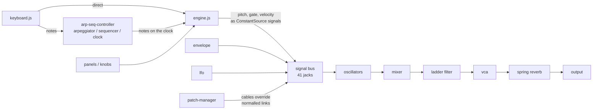

# How Goob Nonna is built

A static site: HTML, one stylesheet and plain ES modules, no framework, no bundler, no runtime dependencies. The
synthesizer is a graph of Web Audio nodes wired like the Moog Grandmother's semi-modular signal path, with a patch
bay you can re-cable. About 5,500 lines of app code (`js/`) in 40 small modules.

The intended behavior, panel by panel, is in [docs/synth-spec.md](docs/synth-spec.md); the user guide is
`docs/getting-started.html`.

## Runtime

| Piece | What it uses |
|---|---|
| Sound | **Web Audio API**: `OscillatorNode`, `BiquadFilterNode`, `ConstantSourceNode` (envelopes, keyboard pitch/gate as signals), `ConvolverNode` (spring reverb), `GainNode` |
| Patch cables | SVG drawn over the panels |
| Timing | The arpeggiator/sequencer clock runs on `setInterval` with tap-tempo override |
| Libraries | None at runtime |

Dev only: Vitest (unit tests), Playwright + axe-core (browser and accessibility tests).

## Files

```
index.html, style.css          the page and all styles
js/main.js                     startup: builds the UI, starts audio on the first note (browser rule)
js/audio/
  audio-context.js             the shared AudioContext
  engine.js                    creates every module, registers patch points, keyboard pitch/gate/velocity
                               as ConstantSource signals, note handling and glide
  modules/                     one file per hardware module: oscillator, mixer, noise, filter (ladder),
                               envelope (ADSR), vca, lfo, reverb (spring), high-pass, attenuator
  routing/signal-bus.js        registry of the 41 patch points (jacks): type, Web Audio node, normalled source
  routing/normalled-connections.js   the 14 default connections the synth plays through with no cables
  routing/patch-manager.js     patching: connect a cable, break the normalled link, restore it when unplugged
js/arp-seq/
  clock.js                     tempo, tap tempo
  arpeggiator.js               note orders (forward, backward, random…), 1–3 octaves, hold
  sequencer.js                 256 steps, 3 slots, tie/rest/accent, transposition
  arp-seq-controller.js        coordinates the three
js/ui/
  layout.js                    assembles the panels and wires them to the engine
  panels/*.js                  one per front-panel section
  components/*.js              knob, slider, switch, button, LED, jack, mod wheel
  keyboard.js                  on-screen and computer keyboard (polyphonic into the arp, monophonic voice)
  patch-cables.js              click-to-connect cables, drawn in SVG
js/presets.js                  factory presets
js/utils/constants.js, math.js patch point IDs, ranges; pure helpers (curves, note math)
tests/unit/                    Vitest: arpeggiator, sequencer, clock, glide, keyboard octave, patching, math
tests/e2e/                     Playwright: smoke, synth flows, axe
```

## How it fits together



## Core techniques

- **Semi-modular routing.** Every jack is registered in the signal bus with its Web Audio node and, for inputs,
  a normalled source. The 14 normalled connections make the synth play with no cables. Patching into an input
  disconnects its normalled source and connects the cable; removing the cable restores it. Control signals
  (keyboard pitch, gate, envelopes) are audio-rate `ConstantSourceNode`s, so any output can modulate any input,
  as on the hardware.
- **Ladder filter.** The Moog −24 dB/oct low-pass is two cascaded 12 dB `BiquadFilterNode`s, with resonance up
  to self-oscillation, keyboard tracking and a bipolar envelope amount.
- **Envelope.** ADSR as `ConstantSourceNode.offset` automation with logarithmic time scaling; decay uses
  `setTargetAtTime` for the exponential curve.
- **Spring reverb.** A `ConvolverNode` with an impulse response generated in code to sound spring-like.
- **Arp and sequencer.** Pure classes (tested without Web Audio by mocking `performance.now()`); the controller
  turns their output into engine notes on the clock. Shift acts as the hardware's HOLD modifier (legato glide).

## Testing and deploy

- `npx vitest run`: the pure logic: arpeggiator orders and hold, sequencer record/playback and transposition,
  clock and tap tempo, glide, keyboard octaves, patching and normalling, math.
- `npx playwright test`: desktop and phone size, synth flows and axe accessibility checks.
- Pushing to `main` runs both in GitHub Actions (the shared workflow in
  [csciuto/app-template](https://github.com/csciuto/app-template)); only if they pass is the site stamped with a
  version and published to GitHub Pages.

## Known limits

- Monophonic voice (as the hardware); the computer keyboard is polyphonic only into the arpeggiator.
- No MIDI input or output yet. meowpiano's MIDI reader/writer and live input (`js/midi.js`, `js/midiin.js` there)
  are the candidate to share.
- The ladder filter is an approximation from built-in biquads, not a model of the transistor ladder.
- Patches and sequences aren't saved or shareable yet.
