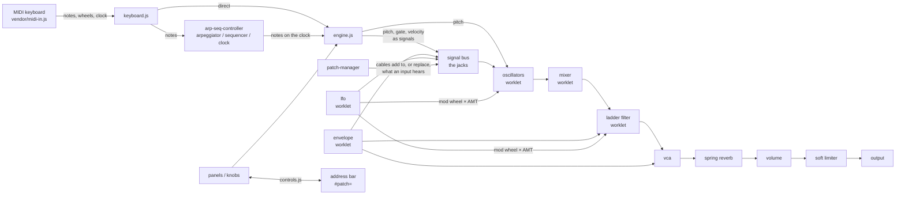

# How Goob Nonna is built

A static site: HTML, one stylesheet and plain ES modules, no framework, no bundler, no runtime dependencies. The
synthesizer is a graph of Web Audio nodes wired like a legendary semi-modular's signal path, with a patch
bay you can re-cable. The parts that give it its sound (oscillators, ladder filter, envelope, LFO) are small DSP
programs running in an AudioWorklet. About 6,000 lines of app code (`js/`) in 47 small modules.

The intended behavior, panel by panel, is in [docs/synth-spec.md](docs/synth-spec.md); the user guide is
`docs/getting-started.html`.

## Runtime

| Piece | What it uses |
|---|---|
| Sound | **Web Audio API**. `AudioWorklet` processors for the oscillators, mixer, ladder filter, envelope, LFO and high-pass (`js/audio/worklets.js`); `ConstantSourceNode` (keyboard pitch, gate and velocity as signals), `ConvolverNode` (spring reverb), `WaveShaperNode` (output limiter), `GainNode` |
| MIDI | **Web MIDI API**, through the shared `midi-in` module, vendored at a pinned version |
| State | The address bar: every knob, switch and cable as `#patch=…` |
| Patch cables | SVG drawn over the panels |
| Timing | The arpeggiator/sequencer clock runs on `setInterval` with tap-tempo override |
| Libraries | None at runtime |

Dev only: Vitest (unit tests), Playwright + axe-core (browser and accessibility tests).

## Files

```
index.html, style.css          the page and all styles
js/main.js                     startup: builds the UI, starts audio on the first press or key (browser rule)
js/audio/
  audio-context.js             the shared AudioContext
  worklets.js                  the DSP cores (oscillator with sync and pulse width, mixer with cable loops,
                               ladder filter, envelope, LFO with sample and hold, one-pole high-pass) and their
                               AudioWorklet wrappers
  engine.js                    creates every module, registers patch points, wires what the hardware wires
                               without a jack, keyboard pitch/gate/velocity as signals, notes, output limiter
  glide.js                     tracks the scheduled pitch so a glide starts from the pitch that is sounding
  modules/                     one file per hardware module: its worklet or nodes plus its jacks and scaling
                               (oscillator, mixer, noise, filter, envelope, vca, lfo, reverb, high-pass, attenuator)
  routing/signal-bus.js        registry of the patch points (jacks): type, Web Audio node, normalled source
  routing/normalled-connections.js   the 8 default connections a cable can replace
  routing/patch-manager.js     patching: connect a cable, break the normalled link, restore it when unplugged
js/arp-seq/
  clock.js                     tempo, tap tempo
  arpeggiator.js               note orders (forward, backward, random…), 1–3 octaves, hold
  sequencer.js                 256 steps, 3 slots, tie/rest/accent, transposition
  arp-seq-controller.js        coordinates the three; clock, run and reset from the rear-panel jacks
  midi-clock.js                MIDI clock ticks to steps, by the RATE knob's note value
js/ui/
  layout.js                    assembles the panels and wires them to the engine
  controls.js                  every sound-shaping control by name (for presets, start-up and links); the link format
  panels/*.js                  one per front-panel section
  components/*.js              knob, slider, switch, button, LED, jack, mod wheel
  keyboard.js                  on-screen and computer keyboard (polyphonic into the arp, monophonic voice)
  diagnostics.js               on-page sound check: start-up errors always; with ?debug, the audio's live state
  patch-cables.js              click-to-connect cables, drawn in SVG
js/presets.js                  factory presets
js/vendor/midi-in.js           the shared MIDI input module (pinned in package.json; `npm run vendor` refreshes it)
js/utils/constants.js, math.js patch point IDs, ranges; pure helpers (curves, note math)
tests/unit/                    Vitest: the DSP cores measured in Node (dsp.test.js), arpeggiator, sequencer, clock,
                               glide, outside clocking, keyboard octave, patching, reverb, math
tests/sound-kit.js             renders the real engine offline and measures it (pitch, levels, envelopes)
tests/e2e/                     Playwright: sound (29 measured tests), presets and links, MIDI, touch (real touch events
                               on the phone project), synth flows, smoke, axe;
                               fingerprint.spec.js, a by-hand sound regression check over every preset;
                               record.spec.js, a by-hand recording of a preset to a WAV
tools/fingerprint-compare.mjs  compares two fingerprints band by band
```

## How it fits together



## Core techniques

- **Everything is a signal, in volts.** Pitch, gate, velocity, envelopes and the LFO are audio-rate signals in
  units of 5 volts (audio ±1, a gate 1.6 for +8 V, pitch inputs 1 volt per octave), so any output can drive any
  input with the hardware's scaling. The keyboard's pitch is itself a signal feeding both oscillators and the
  filter's keyboard tracking, which is why glide, the arpeggiator and KB OUT all move together.
- **Semi-modular routing.** Every jack is registered in the signal bus with its node. Eight inputs have a
  normalled source that a cable replaces and unplugging restores; control inputs sum with what is already there.
  Connections the hardware makes with no jack (envelope to VCA and filter, keyboard to oscillators) are wired
  directly in the engine, so no cable can break them. The four MULT jacks share one node and work in either
  direction.
- **DSP cores, wrapped twice.** `worklets.js` holds each processor as a plain class with a `tick()` method and
  no Web Audio in it, then registers thin `AudioWorkletProcessor` wrappers when it is loaded as a worklet. The
  same file is imported by the unit tests, which run the cores in Node and measure them.
- **Oscillator.** A phase accumulator with polyBLEP correction on every discontinuity (saw wrap, both pulse
  edges, and hard-sync resets), which needs the sample after an edge, so the output runs one sample late.
  Pulse width is a parameter; hard sync restarts the phase at the master's interpolated zero crossing; each
  oscillator has a slow mean-reverting random pitch drift from a seeded generator.
- **Ladder filter.** Four one-pole stages in a feedback loop, every stage saturating the way the transistor
  ladder does: each stage is dy/dt = ωc·(sat(in) − sat(y)) with sat(z) = 2·tanh(z/2) (Huovilainen's model),
  solved without delay in the loop (zero-delay feedback, so the resonant peak sits at the cutoff) with the
  saturations folded in as gains estimated from the last step and refined once. Passband gain falls as
  1/(1+k), the bass loss the hardware has. Quiet it is linear; driven, resonance softens while notes near the
  cutoff thicken. It runs at twice the sample rate (linear interpolation up, a 47-tap half-band FIR down) and
  trims self-oscillation 23 cents up, since the saturation pulls it flat.
- **Mixer and cable loops.** The mixer sums its three inputs and overdrives them softly (at twice the sample
  rate, filtered back down). Web Audio mutes any loop in the graph, so a cable from MIXER OUTPUT back into a
  mixer input never reaches the browser's graph: `engine.findMixerLoop()` follows the cables (through the mult,
  high-pass and attenuator), leaves the closing cable unconnected underneath, and tells the mixer worklet to run
  the loop itself one sample later, through the same high-pass and gain. Inside a loop the overdrive runs at the
  plain rate, since the downsampling filter's delay would turn the feedback into a comb.
- **Envelope.** A gate-driven state machine in the worklet (linear attack, exponential decay and release), so
  anything over 1.2 V can trigger it at audio rate and a retrigger continues from the current level. A second
  output is the VCA's KB RLS shape.
- **Spring reverb.** The impulse response is computed at start-up from a model: three delay loops, each with a
  chain of stretched all-pass filters (dispersion below about 4 kHz, which makes each echo a rising chirp) and
  damping, then a steep low-pass. Seeded, so it is identical on every load; about 25 ms to compute.
- **Output.** VOLUME sits after the reverb; a soft-knee `WaveShaperNode` limiter after that means the output
  never clips.
- **State in the address.** `controls.js` names every sound-shaping control once. That table sends the panel to
  the engine when audio starts, loads presets (every control, defaults where a preset is silent) and encodes
  the panel plus cables as base64url JSON in `#patch=`. Decoding drops anything unknown or out of range.
- **Touch and screen sizes.** Every control listens for pointer events, so mouse, pen and touch work alike;
  knobs, sliders and wheels take `touch-action: none` so a drag turns them, and the keys `pan-x` so a tap plays
  and a sideways swipe scrolls them. One row of panels above 1400 px, two rows of four from 900, stacked below.
- **Arp and sequencer.** Pure classes (tested without Web Audio by mocking `performance.now()`); the controller
  turns their output into engine notes on the clock, which can also be CLOCK IN's edges (reported by a small
  worklet) or MIDI clock. Shift acts as the hardware's HOLD modifier (legato glide).

## Testing and deploy

- `npx vitest run`: the DSP cores measured in Node (oscillator tuning, pulse widths, aliasing, sync; filter
  slope, resonance, self-oscillation pitch; envelope times; LFO and sample and hold), plus the pure logic:
  arpeggiator, sequencer, clock and outside clocking, glide, patching and normalling, the reverb model, math.
- `npx playwright test`: desktop and phone size. `sound.spec.js` builds the real engine on an
  `OfflineAudioContext`, plays it, and checks numbers measured from the audio: one test per module behavior and
  per jack (for example, the attenuator's 1 volt into PITCH IN must raise the pitch exactly an octave).
  `presets.spec.js` loads every preset in two orders and round-trips a share link; `midi.spec.js` feeds MIDI
  bytes; plus synth flows and axe accessibility checks.
- Around a change to the engine: `FP_OUT=before.json npx playwright test fingerprint --project desktop`, then
  the same after, then `node tools/fingerprint-compare.mjs before.json after.json`. It records every preset's
  loudness in octave bands at two notes. Two runs of the same code differ by up to about 5 dB in a band (the
  presets play in real time), so a preset that moves much more than that has changed.
- Pushing to `main` runs both in GitHub Actions (the shared workflow in
  [csciuto/app-template](https://github.com/csciuto/app-template)); only if they pass is the site stamped with a
  version and published to GitHub Pages.

## Known limits

- Monophonic voice (as the hardware); the computer keyboard is polyphonic only into the arpeggiator.
- Values the manual doesn't give (envelope times, modulation depths and curves, the high-pass range, how hard the
  mixer drives, linear-FM scaling, the drift amount) are choices, marked **model value** in the spec.
- The filter and oscillators are models, not circuit simulations. The oscillators run at the output sample rate;
  the filter runs at twice the rate, so its saturation barely aliases.
- The arpeggiator's own clock runs on `setInterval`, so its timing is only as steady as the page's timers.
- Sequences aren't saved in the link; patches are.
- On a touchscreen a drag across the keys scrolls them rather than gliding from key to key.
- No audio input, Eurorack output or MIDI output.
